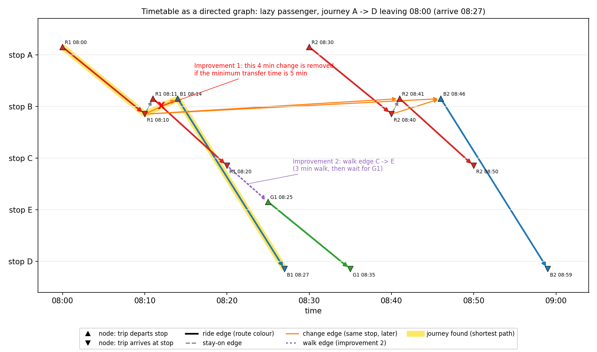

# Q2(a): A directed graph model for timetable journey search

## 1. Construction of a directed graph from timetable data

### 1.1 Terminology and definitions

Terminology varies between data sources. In UK TransXChange data, for instance, a *trip* is termed a "vehicle journey", which is easily confused with a passenger's journey. The following definitions, consistent with the GTFS standard, are therefore adopted throughout.

**Definition 1 (Stop).** A *stop* s ∈ S is a location at which vehicles pick up and set down passengers.

**Definition 2 (Call).** A *call* is a triple c = (s, t^arr, t^dep), recording that a vehicle is at stop s, arriving at time t^arr and departing at time t^dep ≥ t^arr.

**Definition 3 (Trip).** A *trip* z ∈ Z is a single scheduled run of a vehicle, given by an ordered sequence of calls c₁(z), c₂(z), …, c_k(z), with t^arr_{i+1} > t^dep_i for each i.

**Definition 4 (Route).** A *route* is a named collection of trips that serve broadly the same sequence of stops at different times of day. The X1 bus, for example, is a route, not a trip.

**Definition 5 (Timetable).** A *timetable* is the set Z of all trips operating on the day of interest. All times are taken to lie within that day, 00:00–23:59.

**Definition 6 (Leg).** A *leg* is a contiguous part of a single trip z travelled by a passenger, boarding at call c_i(z) and alighting at a later call c_j(z), with j > i.

**Definition 7 (Journey).** A *journey* is a finite sequence of legs ℓ₁, ℓ₂, …, ℓ_m, in which each leg ℓ_{k+1} is on a different trip from ℓ_k and begins where and after ℓ_k ends. A *transfer* is the passage between consecutive legs. A journey with m legs therefore involves m − 1 transfers.

### 1.2 Illustrative example

Consider the timetable in Table 1, which contains three routes, five trips and five stops.

*Table 1: Example timetable.*

| Route | Trip | Calls |
|---|---|---|
| Red | R1 | A 08:00 → B 08:10/08:11 → C 08:20 |
| Red | R2 | A 08:30 → B 08:40/08:41 → C 08:50 |
| Blue | B1 | B 08:14 → D 08:27 |
| Blue | B2 | B 08:46 → D 08:59 |
| Green | G1 | E 08:25 → D 08:35 |

A passenger at stop A at 08:00 wishes to reach stop D as early as possible. No single trip serves both A and D, so any feasible journey must join legs from different trips.

### 1.3 Nodes

A graph whose nodes are stops alone can't represent whether a connection is feasible, because feasibility depends on *when* vehicles are present. The model therefore adopts a *time-expanded* representation (Müller-Hannemann et al., 2007), in which each node is a timetable event.

**Definition 8 (Event nodes).** The node set is V = V^dep ∪ V^arr, where:

- each departure node v = dep(z, s) ∈ V^dep represents trip z departing stop s, at time t(v) = t^dep;
- each arrival node v = arr(z, s) ∈ V^arr represents trip z arriving at stop s, at time t(v) = t^arr.

Each call of a trip contributes one departure node and one arrival node. The exceptions are the first call, which has no arrival node, and the final call, which has no departure node. Each node therefore carries three attributes: a stop, a time and a trip.

### 1.4 Edges

**Definition 9 (Edges).** A directed edge (u, v) ∈ E exists if and only if a passenger in the state represented by u can next be in the state represented by v. A necessary condition is t(v) ≥ t(u). Each edge has weight w(u, v) = t(v) − t(u) ≥ 0, the time elapsed. The edge set is E = E^ride ∪ E^stay ∪ E^change, where:

- **Ride edges:** (dep(z, s_i), arr(z, s_{i+1})) ∈ E^ride for each pair of consecutive calls of trip z. These represent travel between successive stops.
- **Stay-on edges:** (arr(z, s_i), dep(z, s_i)) ∈ E^stay for each intermediate call of trip z. These represent remaining on board while the vehicle dwells.
- **Transfer edges:** (arr(z, s), dep(z′, s′)) ∈ E^change if and only if

  (i) s′ = s, (ii) z′ ≠ z, and (iii) t(dep(z′, s′)) ≥ t(arr(z, s)).

Transfer edges are the mechanism by which legs from different trips are joined. Condition (i) encodes the *lazy-passenger* assumption: the next leg must begin at exactly the stop where the previous leg ended. Condition (iii) ensures that a passenger can only board a vehicle that has not yet departed.

In the example, R1 arrives at B at 08:10 and B1 departs B at 08:14. All three conditions hold, so (arr(R1, B), dep(B1, B)) ∈ E^change with weight 4 minutes. Had B1 departed at 08:05, condition (iii) would fail and no such edge would exist.

**Proposition 1.** If every ride edge has strictly positive duration, then G = (V, E) is a directed acyclic graph (DAG).

*Justification.* Every edge is non-decreasing in time. A cycle would therefore have to consist entirely of zero-weight edges. Any return to a node of trip z requires a ride edge of z, which has positive duration, so no such cycle can exist. ∎

Figure 1 shows the resulting graph for the timetable in Table 1. Time runs along the horizontal axis and stops are arranged vertically. Each trip appears as a chain of ride edges, and transfer edges connect events at the same stop in the direction of increasing time.

*Figure 1: Time-expanded directed graph for the example timetable. ▲ denotes departure nodes and ▼ arrival nodes. Coloured edges are ride edges (by route), grey dashed edges are stay-on edges, and orange edges are transfer edges. The shaded path is the earliest-arrival journey from A to D departing at or after 08:00. The cross and the purple dotted edge illustrate the extensions in Section 3.*

---

## 2. Reduction of journey search to path search

**Definition 10 (Journey query).** A *journey query* is a triple (o, d, τ₀), comprising an origin stop o, a destination stop d and an earliest departure time τ₀. An *earliest-arrival journey* is a feasible journey from o to d, departing no earlier than τ₀, whose arrival time at d is as small as possible.

To answer a query, G is augmented with two auxiliary nodes:

- a **source node σ**, with an edge (σ, v) of weight t(v) − τ₀ to every departure node v with stop(v) = o and t(v) ≥ τ₀;
- a **sink node ω**, with an edge (v, ω) of weight 0 from every arrival node v with stop(v) = d.

**Proposition 2.** There is a one-to-one correspondence between σ–ω paths in the augmented graph and feasible journeys answering (o, d, τ₀). Moreover, the length of a σ–ω path equals the arrival time at d minus τ₀.

*Justification.* By construction, each edge corresponds to a physically feasible passenger movement, so every σ–ω path describes a feasible journey. Conversely, any feasible journey is a sequence of rides, dwells and transfers, each of which appears as an edge. Edge weights are time differences, so along any path the sum telescopes to t(final node) − τ₀. ∎

It follows that:

1. **Existence.** A journey exists if and only if ω is reachable from σ. This may be tested by breadth-first search.
2. **Optimality.** The earliest-arrival journey corresponds to the shortest σ–ω path. All weights are non-negative, so this may be found with Dijkstra's algorithm. Because G is acyclic (Proposition 1), it may also be found in linear time by relaxing the edges in topological order, which is equivalent to processing events in chronological order.
3. **Interpretation.** The journey is recovered from the path. Each maximal run of ride and stay-on edges belonging to one trip constitutes a leg, and each transfer edge marks a transfer. The number of legs is |E^change ∩ path| + 1.
4. **Generality.** A path may alternate ride and transfer edges arbitrarily often, so journeys with any number of legs are found without specifying the number of transfers in advance.

For the query (A, D, 08:00), the shortest path is

σ → dep(R1, A) → arr(R1, B) → dep(B1, B) → arr(B1, D) → ω,

with length 27 minutes. This is a journey of two legs, R1 from A to B and B1 from B to D, with one transfer at B and arrival at 08:27 (Figure 1, shaded path).

---

## 3. Extensions to the graph representation

Both extensions modify only the set of edges that join successive legs. The node set V, the ride and stay-on edges, and the path-search procedure of Section 2 are unchanged.

### 3.1 Minimum transfer time

In practice a transfer requires time to alight, move to the boarding point and board.

**Definition 11 (Minimum transfer time).** Let δ: S → ℝ≥0 assign to each stop s a *minimum transfer time* δ(s).

Condition (iii) of the transfer-edge definition is strengthened to

  (iii′) t(dep(z′, s)) ≥ t(arr(z, s)) + δ(s).

Stay-on edges are unaffected, since remaining on the same vehicle requires no transfer. The function δ may vary by stop, reflecting, for example, the difference between a large interchange and a single kerbside stop. GTFS provides such values in the optional `transfers.txt` file.

With δ ≡ 5 minutes in the example, the transfer from R1 to B1 at B (4 minutes) violates (iii′), and the corresponding edge is removed (the cross in Figure 1). The shortest path instead transfers to B2 at 08:46, and the earliest arrival becomes 08:59.

### 3.2 Walking between nearby stops

Relaxing the lazy-passenger assumption allows a passenger to alight at one stop and board at another within walking distance.

**Definition 12 (Walking time).** For stops s ≠ s′, let

  f(s, s′) = (detour factor) × dist(s, s′) / v_walk,

defined for pairs with dist(s, s′) ≤ r, where:

- dist is the great-circle distance between the stops' coordinates;
- v_walk is a walking speed (approximately 1.3 m/s);
- r is a maximum walking radius (for example, 400 m).

A new set of **walk edges** E^walk is added, where (arr(z, s), dep(z′, s′)) ∈ E^walk if and only if

  (i) dist(s, s′) ≤ r, (ii) z′ ≠ z, and (iii) t(dep(z′, s′)) ≥ t(arr(z, s)) + f(s, s′).

The weight is again the elapsed time. Similar edges may be added from σ to departures at stops within walking distance of o, and from arrivals at stops near d to ω, to represent walking at the start and end of a journey. Where greater accuracy is needed, f may be computed from a pedestrian network, for example derived from OpenStreetMap, instead of from straight-line distance.

In the example, stops C and E are separated by a 3-minute walk. This produces the walk edge (arr(R1, C), dep(G1, E)) with weight 5 minutes: 3 minutes walking and 2 minutes waiting. With δ ≡ 5 minutes and walking permitted, the earliest-arrival journey becomes R1 from A to C, a walk to E, then G1 to D, arriving at 08:35. This improves on the 08:59 arrival obtained without walking.

*Table 2: Earliest-arrival journeys for the query (A, D, 08:00) under each model.*

| Model | Rule for joining legs | Earliest-arrival journey | Arrival |
|---|---|---|---|
| Lazy passenger | same stop, t′ ≥ t | R1 (A→B), B1 (B→D) | 08:27 |
| Minimum transfer time | same stop, t′ ≥ t + δ(s) | R1 (A→B), B2 (B→D) | 08:59 |
| Transfer time and walking | as above, or nearby stop with t′ ≥ t + f(s, s′) | R1 (A→C), walk (C→E), G1 (E→D) | 08:35 |

---

### References

Müller-Hannemann, M., Schulz, F., Wagner, D. and Zaroliagis, C. (2007) 'Timetable information: models and algorithms', in *Algorithmic Methods for Railway Optimization*, Lecture Notes in Computer Science 4359. Berlin: Springer, pp. 67–90.

Pyrga, E., Schulz, F., Wagner, D. and Zaroliagis, C. (2008) 'Efficient models for timetable information in public transportation systems', *ACM Journal of Experimental Algorithmics*, 12, Article 2.4.
